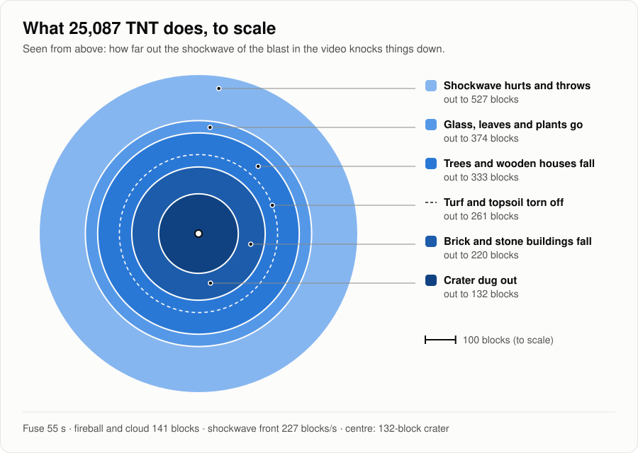
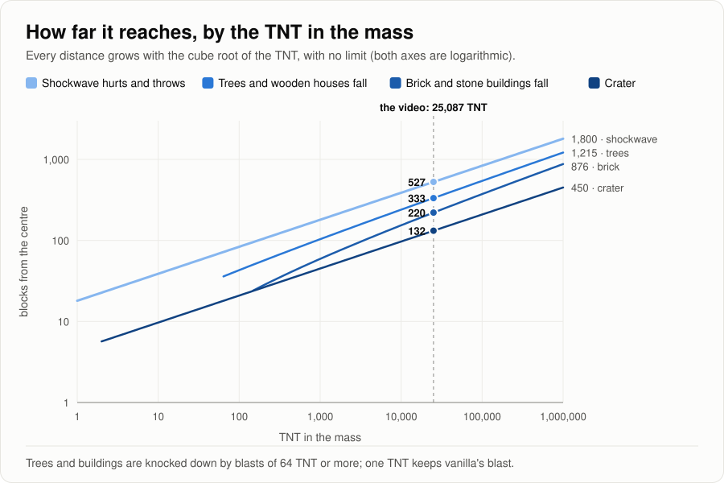

# Realistic TNT

**Explosions that look, sound and hit like the real thing, for [Horizon](https://github.com/horizon-rust/horizon),
the Rust rewrite of Minecraft Java Edition 26.3.** A native mod: a fireball and a mushroom cloud, a
visible shockwave that hurts, throws and flattens what it sweeps over, a real crater, flying debris, and
a boom you hear when the shockwave reaches you. TNT adds up: the more you pile, the bigger it gets,
with no limit.

*Made with [Claude Code](https://claude.com/claude-code), using Claude Opus 5.5 and Claude Fable 5.2.*


**▶ The full clip, with sound** (15 s, 1080p 60 fps): 25,087 TNT, watched from about 300 blocks
away. Shown with the `wisdom_horizon_tnt` shader pack from this repository.

https://github.com/user-attachments/assets/d2015f20-e6d9-42c7-b8ef-e2eb0959690b

## The blast in the video: 25,087 TNT

A cube of 25,087 TNT, lit with flint and steel. The countdown over the hotbar gave **55 seconds** to fly
away; the shockwave reached **527 blocks**.



| | 25,087 TNT |
|---|---|
| Fuse (time to get away) | 55 s, counted down over the hotbar |
| Fireball and mushroom cloud | 141 blocks, lasting 65 s |
| Crater | 132 blocks out from the centre, charred floor, magma near the middle |
| Brick and stone buildings fall | out to 220 blocks |
| Turf and topsoil torn off | out to 261 blocks |
| Trees and wooden houses fall | out to 333 blocks |
| Glass, leaves and plants go | out to 374 blocks |
| Shockwave hurts and throws mobs and players | out to 527 blocks, its front running at 227 blocks a second |
| Damage at the centre | 468 health points (`minecraft:explosion`), falling off with the square of the distance |
| Knockback | 40 times vanilla's push, capped at Horizon's top speed |

## How it scales

Every explosion has a **yield** in TNT: one TNT is 1, a creeper about 0.4, a bed or a respawn anchor
about 2, an end crystal about 3.4. TNT blocks touching an explosion go off with it at once (up to
200,000 of them), and explosions close together within two seconds are one blast whose yield is their
sum. Everything grows with the **cube root of the yield**, as real blasts do, with no limit.



Distances in blocks from the centre of the blast:

| TNT | Fuse | Crater | Brick and stone fall | Turf torn off | Trees and wood fall | Glass and plants go | Shockwave reach | Front speed |
|---:|---:|---:|---:|---:|---:|---:|---:|---:|
| 1 | 4 s | vanilla's | — | — | — | — | 18 | 42 blocks/s |
| 27 | 7.6 s | 14 | — | — | — | — | 54 | 73 blocks/s |
| 512 | 16.6 s | 36 | 44 | 57 | 81 | 94 | 144 | 119 blocks/s |
| 4,096 | 31 s | 72 | 107 | 132 | 174 | 198 | 288 | 168 blocks/s |
| **25,087** (the video) | 55 s | 132 | 220 | 261 | 333 | 374 | 527 | 227 blocks/s |
| 1,000,000 | 3 min | 450 | 876 | 1,000 | 1,215 | 1,338 | 1,800 | 420 blocks/s |

Land is torn up past the crater by blasts of 64 TNT or more; a single TNT keeps vanilla's blast, with
the mod's effects on top.

## TNT blocks

The mod adds seven higher-yield TNT blocks under the **Realistic TNT** creative tab, so huge blasts
do not need thousands of placed blocks:

| Block | ID | Worth (in TNT) | Shapeless recipe |
|---|---|---:|---|
| TNT x2 | `realistic_tnt:tnt_x2` | 2 | 2 × TNT |
| TNT x10 | `realistic_tnt:tnt_x10` | 10 | 5 × TNT x2 |
| TNT x100 | `realistic_tnt:tnt_x100` | 100 | 9 × TNT x10 |
| TNT x1,000 | `realistic_tnt:tnt_x1000` | 1,000 | 9 × TNT x100 |
| TNT x10,000 | `realistic_tnt:tnt_x10000` | 10,000 | 9 × TNT x1,000 |
| TNT x100,000 | `realistic_tnt:tnt_x100000` | 100,000 | 9 × TNT x10,000 |
| TNT x1,000,000 | `realistic_tnt:tnt_x1000000` | 1,000,000 | 9 × TNT x100,000 |

They break instantly and drop themselves when mined, and light as vanilla TNT does:

- **Redstone:** any adjacent redstone signal lights them, including immediately if placed where a
  signal already reaches.
- **Flint and steel / fire charge:** right-clicking lights the block (wearing down the flint and
  steel or using a fire charge outside Creative).
- **Fire and explosions:** spreading fire and nearby blasts prime them instead of breaking them.

Each lit block spawns a primed TNT showing that block's own texture and explodes with its full
worth. Touching TNT blocks — vanilla or valued — still fold into one mass and add their worths
together, up to `10,000,000` TNT per blast.

## Remote detonator

The **Remote Detonator** (`realistic_tnt:detonator`, under the **Realistic TNT** creative tab)
is crafted from 1 redstone torch, 3 iron ingots and 1 redstone dust:

- **Link / unlink:** right-click any vanilla or valued TNT block to link it to that detonator
  (up to 64 links per detonator, stored per dimension on the item); right-click a linked block
  again to unlink it.
- **Fire:** right-click in the air to light every linked TNT block at once with a fixed **5 second
  (100 tick)** fuse, overriding the mod's stretched fuse while keeping touching blocks folding into
  one mass and summing their worths. Links are cleared on firing; blocks that were broken or
  replaced, or that lie in unloaded chunks, are skipped and reported.

## What every explosion does

TNT, creepers, beds, end crystals: every explosion gets all of this.

| Part | What happens | Needs the shader pack |
|---|---|---|
| Fireball | A white-hot ball that cools to yellow, orange and red as it rises, lighting the land round it. | yes |
| Mushroom cloud | The fireball rolls up into black smoke on a stem, which greys, spreads and fades. | yes |
| Flash | The whole picture whitens for an instant (an option of the pack; 0 turns it off). | yes |
| Shockwave | A sphere of bent air races out, with colour fringes. | yes |
| Dust skirt | A low ring of dust races out along the ground and settles. | yes, plus dust pillars without it |
| Condensation ring | Round a big blast's mushroom (from about 64 TNT, in full from a few thousand), the shockwave chills the damp air into a ragged white ring (a Wilson cloud) that drifts slowly outwards and frays away. | yes |
| Debris | Plain terrain and wood the blast breaks flies as falling blocks, trailing smoke, and lands as rubble. Ores, containers and block-entity blocks are left to the blast, so loot is not lost. | no |
| Sparks, flames, crumbs | A flash particle, lava sparks, a burst of flame and crumbs of the ground it tore up. | no |
| Smoke and ash | A column of smoke with a cloud at its top, embers at its foot, ash falling afterwards. | no |
| Scorched ground | Grass and soil round the crater char to coarse dirt, plants burn away. | no |
| Camera shake | A jolt as it goes off, then a shake when the shockwave reaches you (scaled by the game's Distortion Effects option). | no |
| Sound | Heard as a real blast is (after the 2020 Beirut blast's recordings): the fireball's roar with the flash, the ground rumbling ahead of the air wave, then, as the shockwave arrives, a sharp crack and the boom (heavy close by, a dull thud far off, where the air has taken its high pitches), the boom rolling on like thunder, debris raining down, and close by the ears ringing while the world sounds muffled. It grows with the yield: one TNT is a crisp, punchy bang; tens of TNT shake the ground; a nuclear-sized blast roars for seconds, rolls on for twenty and its wind howls after it. The booms, rumbles, debris and cracks are real explosions, recorded (the SSE Library's *EXPLOSIONS*, USC Cinema / Sunset Editorial, CC0 1.0, on the Internet Archive), given back the deep lows old tape lost and the chest-thumping blow of a blast felt close by; the flash, ground, wind and ringing are synthesised (`assets/realistic_tnt/sounds/`, all made by `tools/make_sounds.py`); vanilla's explosion sound is dropped, so the blast is not heard twice. | no |
| Shockwave damage and push | As the front reaches them, mobs and players are hurt and thrown away from the blast, less the farther out. | no |
| Knockback | The explosion's own push is 35% harder, times the cube root of the yield. | no |
| Crater | A blast of more than one TNT digs its own crater, ring by ring as its front passes: a bowl, everything above it cut away, a charred floor (blackstone, coarse dirt, magma near the middle), the land round it scorched, blocks flung out of it. | no |
| Land torn up | A blast of 64 TNT or more knocks down what its shockwave sweeps over beyond the crater, by how hard it still pushes there: glass, leaves, plants, wool and torches first, then wood (trees, wooden houses, doors, fences), then the turf, then brick, cut stone, cobblestone and concrete. As much of it as the game allows flies up and away where players can see it. Natural rock, ores, metal and blocks holding things (chests, signs, beds) stay. | no |
| Crater rim | The ground the crater throws out piles round it: a raised rim about a seventh of the crater's radius high at its crest, thinning out to almost twice its radius. | no |
| Walls slide in | Once a crater of 6 blocks or more is dug, its steep walls keep breaking off and sliding into it for a few seconds (up to half a minute for the biggest). | no |
| Fires | A blast of 16 TNT or more sets the land round its crater alight, out past where its shockwave knocks the trees down (at least 2.5 times the crater's radius), so the forest still standing catches; the game's fire spreads it from there (`FIRE`). | no |
| Debris craters | Ground the blast throws far comes down hard and digs a small crater of its own where it lands, with a puff of dust. | no |
| Baked ground | The heat bakes the crater's whole bowl two blocks deep, each material as it would: sand and sandstone to glass, stone, cobblestone and deepslate to blackstone, stone bricks crack, soil to coarse dirt, clay to terracotta, mud dries, gravel fuses to tuff, snow, ice and leaves go, netherrack glows to magma. What the crater throws out and its walls shed comes down baked the same way. Rock in the middle melts to magma, and under 64 TNT or more some of it to obsidian. | no |

## Lighting a big mass

**A bigger mass burns longer.** TNT lit in a mass gets vanilla's 4 seconds plus the time it takes to
fly out of the shockwave's reach at 10 blocks a second (`ESCAPE_SPEED`). TNT on its own keeps vanilla's
fuse.

**A countdown** over the hotbar shows the mass, the seconds left and the shockwave's reach:
`25,087 TNT: explodes in 51 s, reach 527 blocks`. It reads the lit TNT's own fuse every tick, so it
ends exactly as the TNT goes off. Then it tells you when the shockwave will reach you
(`25,087 TNT went off! The shockwave reaches you in 2 s`), or that you are out of its reach.

**It goes off on time however far you fly.** While a mass burns, the mod holds the chunks round it
loaded and ticking (the TNT's, the mass's, and out to the land its shockwave tears up, at most 16
chunks out), so it does not freeze when you leave it behind. The chunks are let go once the crater is
dug; a world closed while a mass burns lets go of them when it is opened again.

**The whole mass goes together.** TNT lit later in a mass that is already burning (a second one lit, a
redstone signal reaching several blocks, fire spreading over it) takes the same fuse, and another
blast does not throw the lit TNT out of its mass.

## Install

Realistic TNT is a native mod: real code, compiled for **one exact Horizon**, Nightly 2026-11-22
([`f1bb66f`](https://github.com/horizon-rust/horizon/commit/f1bb66f353cf67f2aa4665293fc75c8d91186fc7)).
The launcher builds it for that Horizon and keeps an instance on it, so a later Horizon update does
not break your TNT worlds. Give the mod an instance of its own: your main game stays as it is.

**You need** Horizon's launcher 0.2.70 or newer ([playhorizon.dev](https://playhorizon.dev)), signed
in with an account that owns Minecraft: Java Edition.

### 1. Make an instance for the mod

In the launcher: **Instances > New instance**, name it `Realistic TNT`. Or:

```sh
horizon-launcher instance create "Realistic TNT"
```

### 2. Install the mod into it

In the launcher: pick the `Realistic TNT` instance, open **Mods > Add from GitHub**, paste

```
https://github.com/stealer0002/horizon-realistic-tnt/releases/tag/v0.11.0
```

and allow native code. Or:

```sh
horizon-launcher mods add-github https://github.com/stealer0002/horizon-realistic-tnt/releases/tag/v0.11.0 --instance "Realistic TNT" --trust-native-code
```

That installs the mod; now build it into the instance:

```sh
horizon-launcher native-build --instance "Realistic TNT" --trust-native-code
```

The launcher compiles the mod against the Horizon it pins (Nightly 2026-11-22, `f1bb66f`; a few
minutes the first time) and makes the instance play that build. A native mod runs with your rights,
which is why the launcher asks you to trust it: the whole source is in this repository.

### 3. Play

Select the instance and press **Play**. The TNT blocks and the detonator are in the creative tab
**Realistic TNT**, or `/give @p realistic_tnt:tnt_x1000` and `/give @p realistic_tnt:detonator`.

### Keep it playable after Horizon updates

- The instance stays on the Horizon it was built for. A Horizon update installs beside it and
  doesn't move it; just don't rebuild this instance with `--update` (the launcher's "update mods to
  the newest Horizon").
- Don't let the launcher delete the Horizon it needs:
  ```sh
  horizon-launcher settings prune-old-versions off
  ```
- **If the mod stopped working** (no Realistic TNT tab, the game says a mod was left out), the
  instance was moved to another Horizon. Put it back on the mod's build:
  ```sh
  horizon-launcher versions --installed
  horizon-launcher instance version "Realistic TNT" native-f1bb66f-XXXXXXXXXXXX
  ```
  (the `native-f1bb66f-…` line the first command lists), or build it again on its Horizon:
  ```sh
  horizon-launcher native-build --instance "Realistic TNT" --version nightly-2026-11-22-f1bb66f --trust-native-code
  ```
- When a version of the mod for a newer Horizon comes out, install it into a new instance the same
  way, and keep this one until you've tried it.

### From the source (developers)

```sh
horizon-launcher native-build realistic_tnt --instance <your instance> --version nightly-2026-11-22-f1bb66f --trust-native-code
```

`realistic_tnt/` is the mod's project on its own (the folder a `.hmod` is packed from), so the shader
packs, scripts and media live beside it. `cargo horizon-mod build` in it writes
`target/horizon-mod/realistic_tnt.hmod`.

**Shader pack.** Pick the shader pack for the fireball, the cloud, the flash and the shockwave. The mod
installs its own pack: when the game starts, it writes "Realistic TNT: explosions" into the game's
`shaderpacks/realistic_tnt_shockwave/` folder (and updates it when a newer mod carries a newer pack).
Pick it in Options > Video Settings > Shaders; the mod never changes the pack you picked. The packed
files below are the same packs, for players who want them on their own.

| Pack | What it is |
|---|---|
| `realistic_tnt_shockwave-0.6.0.hshader` | The explosion pass alone, over the game's vanilla look (shader API 0.2). The mod installs this one by itself |
| `wisdom_horizon_tnt-1.3.7-tnt6.hshader` | Wisdom Shaders V3 (Horizon port) with the explosion pass added: the look in the video. It is a shader API 0.1 pack, which Horizon no longer loads since 2026-11-13: kept for older builds only |

Without a shader pack, everything marked "no" in the table above still works.

## Command

Use `/tnt <n>` while aiming at a block within 128 blocks. The command requires a player with
operator level 2 or higher and accepts whole numbers from 1 to 200,000. For example, `/tnt 64`
sets off one explosion with the yield of 64 TNT at the point your aim hits. It places no TNT
blocks. Existing TNT touching the explosion can add to its yield as usual.

## Tuning

Create `config/realistic_tnt.conf` inside the Horizon instance directory. For a dedicated server,
use that server's instance directory. The native mod reads the UTF-8 file once during registration.
Restart Horizon after editing it. You can omit any key to use its default. Blank lines and
comments beginning with `#` are allowed. Invalid entries are ignored and reported to stderr.

```ini
ESCAPE_SPEED = 10
MAX_FOLD = 200000
HOLD_CHUNKS = 16
LIFT_YIELD = 64
BREAKS_AT = 0.5, 0.8, 1.5, 2.0
SCORCH = true
FIRE = true
KNOCKBACK = 1.35
```

| Key | Accepted values | What it controls |
|---|---|---|
| `ESCAPE_SPEED` | Positive finite number | Assumed escape speed in blocks per second. Lower values give larger TNT masses a longer fuse. |
| `MAX_FOLD` | Positive integer | Maximum TNT blocks one explosion takes in at once. |
| `HOLD_CHUNKS` | Integer from 1 to 32 | Radius cap, in chunks, for the area held around a burning mass. |
| `LIFT_YIELD` | Positive finite number | Minimum TNT yield that tears up land beyond the crater. |
| `BREAKS_AT` | Four finite, nonnegative numbers in strictly increasing order | Shockwave push, in blocks per tick, needed to knock down glass and plants, wood, turf, then brick and stone. |
| `SCORCH` | `true` or `false` | Whether explosions scorch the surrounding land. |
| `FIRE` | `true` or `false` | Whether blasts of 16 TNT or more set fires round their crater, which then spread as fire does. |
| `KNOCKBACK` | Finite, nonnegative number | Multiplier for the explosion's initial knockback. |

## Limits

- A huge mass freezes the game for a moment as it goes off (the mod walks the whole mass), and a huge
  crater takes a few seconds to dig.
- Horizon keeps at most 1024 falling blocks in a world: what a big shockwave knocks down flies while
  there is room (as flying blocks land, more fly), only within 160 blocks of a player, and the rest is
  simply gone. It looks 40 blocks down from the top of each column at most.
- The fireball, cloud, flash, shockwave picture, camera shake and delayed boom read the blasts from
  the game's own memory: they work in single player and for the host of a LAN game, not for guests or
  on a dedicated server. Debris, particles, craters, damage, knockback and the countdown work
  everywhere.
- The shockwave throws the window's own player; other players in a LAN game are hurt but not thrown.
- A world saved and reopened while a mass burns keeps the TNT's long fuse, but not its countdown nor
  its held chunks.
- The shader pack draws three blasts at a time: the biggest and youngest.
- Particles are seen up to 32 blocks away, as vanilla's are; the fireball and cloud are seen from any
  distance.
- **Photosensitivity:** explosions flash. The pack's "Explosion flash" option at 0 removes the flash.

## Repository layout

```
realistic_tnt/                 the mod's project: what `native-build` builds and `.hmod` packs
  horizon-mod.toml             id, version, the Horizon build it is made for
  src/lib.rs                   the blast, fuse, valued-TNT and effects logic, with unit tests
  src/command.rs               server-side /tnt command
  src/config.rs                instance tuning and config parser tests
  src/destruction.rs           crater rim, wall slumping, blast fires, baked ground and debris craters
  src/detonator.rs             remote detonator item behaviour and link-list tests
  src/shader_pack.rs           installs the explosion shader pack into shaderpacks/ on start
  src/shader_pack_files.rs     that pack's files, generated by tools/embed_shader.py
  assets/realistic_tnt/        valued TNT and detonator models, textures, lang files and blast sounds
  data/realistic_tnt/          valued TNT blocks, detonator item, recipes, loot tables and creative tab
shader/
  realistic_tnt_shockwave/     the explosion pass on its own (source)
  wisdom_horizon_tnt/          Wisdom Shaders V3 (Horizon port) with that pass added (source)
  *.hshader                    the same packs, packed, ready to drop into shaderpacks/
tools/
  check.ps1                    checks and unit-tests the mod with the pinned build's mod SDK
  embed_shader.py              packs shader/realistic_tnt_shockwave/ and embeds it in the mod:
                               run it after every change to the shader
  make_blocks.py               writes the valued TNT blocks, textures, recipes, loot and lang files
  make_sounds.py               generates the blast's .ogg sound files under assets/realistic_tnt/sounds/
                               (fetches its CC0 recordings into tools/sounds-source/ the first time)
  diagrams.py                  draws media/blast-*.svg from the mod's own formulas
  shoot.py, bigtest.py, ...    drive a test copy of the game through `horizon-ctl` to photograph
                               explosions and check fuses, far-away blasts and torn-up land
media/                         the clip, its preview and the diagrams
```

The shader pass and the mod share numbers that must stay the same in both: the layout of `frame.mods`,
the shockwave's speed (`SHOCK_SPEED`, `TNT_SHOCK_SPEED`), a blast's life (`LIFE_SECS`, `TNT_LIFE`) and
the curves of the mushroom and of the dust ring. `post/shockwave.wgsl` is the same pass in both packs;
the explosion pack's copy is the shader API 0.2 one, which works in linear light.

## License and credits

- Made with [Claude Code](https://claude.com/claude-code), Anthropic's coding agent, using the
  Claude Opus 5.5 and Claude Fable 5.2 models: the mod's code, the shader pass, the test scripts, the
  diagrams and this README were written with it.
- Also made with Google's [Antigravity](https://antigravity.google), using the Gemini 4 Neon and
  Gemini 4 Hydrogen models: valued TNT going off at its full worth, the remote detonator, the
  natural crater rims and the shockwave that kills what it reaches (0.10.0 and 0.11.0).
- The blast sounds are cut from real explosions recorded in the SSE Library's *EXPLOSIONS* (USC
  Cinema / Sunset Editorial), released under CC0 1.0 on the
  [Internet Archive](https://archive.org/details/SSE_Library_EXPLOSIONS).
- The mod, the explosion shader pass and the scripts: MIT ([LICENSE](LICENSE)).
- `shader/wisdom_horizon_tnt/` is a modified copy of **Wisdom Shaders V3 (Horizon port)**: Wisdom
  Shaders by bobcao3, ported to Horizon by tomasmendes01, under the Apache License 2.0
  ([its LICENSE](shader/wisdom_horizon_tnt/LICENSE.txt)). The changes are listed in
  [its README](shader/wisdom_horizon_tnt/README.md).
- Horizon is its own project; this mod is not affiliated with it, nor with Mojang or Microsoft.
