<p align="center">
  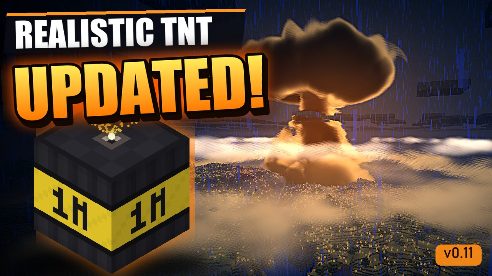
</p>

<h1 align="center">Realistic TNT</h1>

<p align="center">
  <b>Explosions that look, sound and hit like the real thing.</b><br>
  A native mod for Horizon, the Rust rewrite of Minecraft Java Edition 26.3.
</p>

<p align="center">
  <a href="https://github.com/stealer0002/horizon-realistic-tnt/releases/tag/v0.11.0"></a>
  <a href="https://github.com/horizon-rust/horizon/commit/f1bb66f353cf67f2aa4665293fc75c8d91186fc7"></a>
  
  <a href="LICENSE"></a>
</p>

---

## New here? Start here

**Want to play it? It takes about 5 minutes and three copy-and-paste commands.**

1. Get the **Horizon launcher** from [playhorizon.dev](https://playhorizon.dev) and sign in with an
   account that owns Minecraft: Java Edition.
2. Follow the **[install guide](#install)**. Every step says exactly what to paste and what you
   should see.
3. Pick the `Realistic TNT` instance and press **Play**.
4. **Switch on the shader pack, once, before you light anything.** It is installed for you but starts
   switched off. In the game: **Options > Video Settings > Shaders > Shader Packs...**, then click
   **Realistic TNT: explosions** until it says **On** ([step 5](#step-5-turn-on-the-shader-pack)).
   Without it you get the crater and the debris, but no fireball, mushroom cloud or shockwave.

**Good to know before you start:**

- **Horizon is its own game and launcher** (a Rust rewrite of Minecraft Java Edition 26.3). Realistic TNT
  only runs on Horizon. It does **not** work on regular Minecraft, Fabric, Forge or NeoForge, and it
  is not on CurseForge or Modrinth: the download is on this page.
- **It is not a file you drop into a folder.** The launcher builds the mod for Horizon, which is what
  the three commands in the install guide do.
- **Your main game stays as it is.** The mod gets an instance of its own.

> [!WARNING]
> **Horizon's GitHub is down for now (not this mod's fault).** GitHub's automated anti-spam filter
> flagged Horizon's `horizon-rust` organisation, so its GitHub links and downloads return 404 until
> GitHub clears the flag. It is not a takedown. **If you already built Realistic TNT, keep playing:
> installed copies work normally.**
>
> **New installs work through a mirror.** The Horizon team mirrors the signed mod SDK at
> `https://horizon-mirror.nikitagrimm.de` (announced on Horizon's Discord), and it has the exact SDK
> this mod needs (Nightly 2026-11-22, `f1bb66f`). The [install guide](#install) below shows the one
> extra line to type first. This page will be updated when GitHub is back.

A fireball and a mushroom cloud. A visible shockwave that hurts, throws and flattens what it sweeps
over. A real crater, flying debris, and a boom you hear when the shockwave reaches you. TNT adds up:
the more you pile, the bigger the blast, up to 10,000,000 TNT going off as one.

Made for [Horizon](https://playhorizon.dev) Nightly 2026-11-22
([`f1bb66f`](https://github.com/horizon-rust/horizon/commit/f1bb66f353cf67f2aa4665293fc75c8d91186fc7)).
**▶ [Watch the 0.11 showcase](https://youtu.be/rC_2Uwb9i0E)** · *Made with [Claude Code](https://claude.com/claude-code) and Google [Antigravity](https://antigravity.google).*

**Jump to:** [Install](#install) · [What's new](#whats-new-in-011) · [Old vs new](#old-vs-new) · [Gallery](#gallery) ·
[TNT blocks](#tnt-blocks) · [Remote detonator](#remote-detonator) · [How it scales](#how-it-scales) ·
[Tuning](#tuning)

## What's new in 0.11

Full notes on the [v0.11.0 release](https://github.com/stealer0002/horizon-realistic-tnt/releases/tag/v0.11.0).
0.10.0 was never released on its own, so its changes are listed here too.

- **Bigger TNT blocks.** Seven new blocks worth 2, 10, 100, 1,000, 10,000, 100,000 and 1,000,000 TNT,
  each with a crafting recipe. Light them with redstone, flint and steel, a fire charge, fire or a
  nearby blast. Touching TNT adds its worth into one blast, up to 10,000,000 TNT. See
  [TNT blocks](#tnt-blocks).
- **Remote detonator.** Link up to 64 TNT blocks, then set them all off from anywhere with a 5 second
  fuse. Blocks that were broken or are out of reach are skipped, and it tells you how many. See
  [Remote detonator](#remote-detonator).
- **Real blast sounds.** Real recorded explosions (the SSE Library's *EXPLOSIONS*, CC0), made heavier, that grow with the blast: a crisp bang for
  one TNT, a long roar for a nuclear-sized one.
- **Condensation ring.** A white Wilson cloud forms round the mushroom of a big blast (shader pack 0.6.0).
- **Natural craters.** The rim is now low and ragged, not a wall.
- **The shockwave kills.** Mobs no longer shrug it off through their invulnerability frames, and iron
  golems close by die.
- **Fixes.** Creeper blasts break blocks again. Unloaded chunks no longer stop crater walls from
  sliding in.

## Gallery

<table>
  <tr>
    <td width="50%">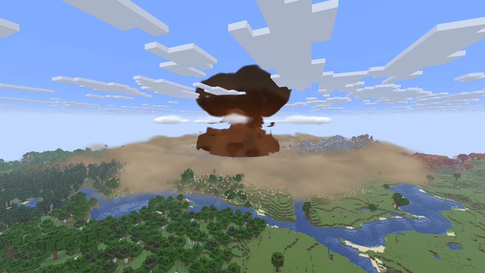<br><sub><b>The ring.</b> 10,000 TNT, 6 s in: the mushroom climbs and a white condensation ring spreads round its stem.</sub></td>
    <td width="50%">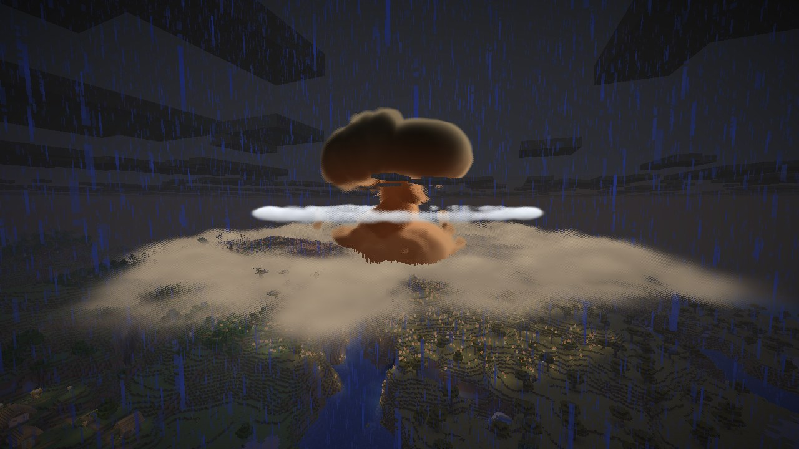<br><sub><b>In the storm.</b> The same 10,000 TNT under rain: a dark mushroom and its ring against a black sky.</sub></td>
  </tr>
  <tr>
    <td>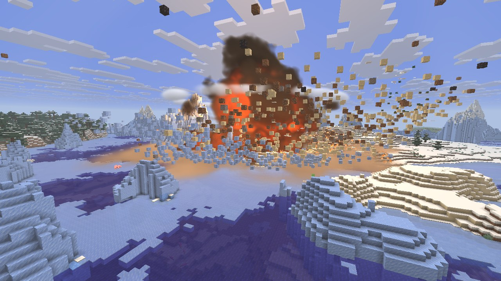<br><sub><b>Half a second.</b> 1,000 TNT, 0.5 s in: the fireball bursts and the ground is torn up and thrown.</sub></td>
    <td>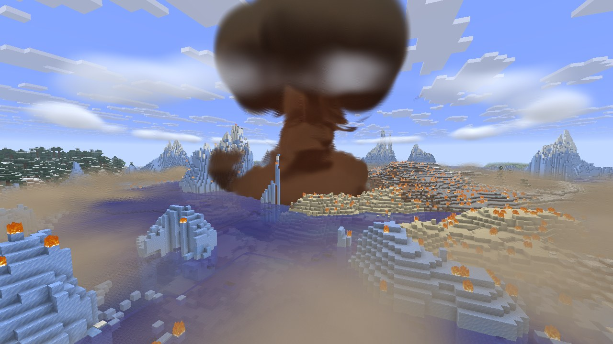<br><sub><b>Over the ice.</b> 1,000 TNT, 6 s in: the mushroom stands over frozen hills.</sub></td>
  </tr>
  <tr>
    <td>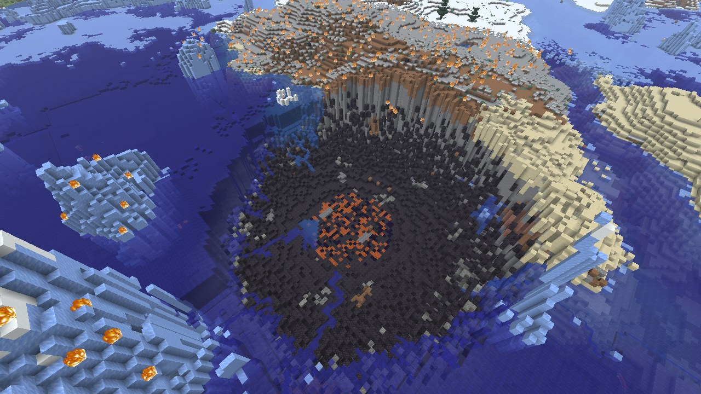<br><sub><b>What 1,000 TNT leaves.</b> A charred bowl with magma at its heart, and water already flowing in.</sub></td>
    <td>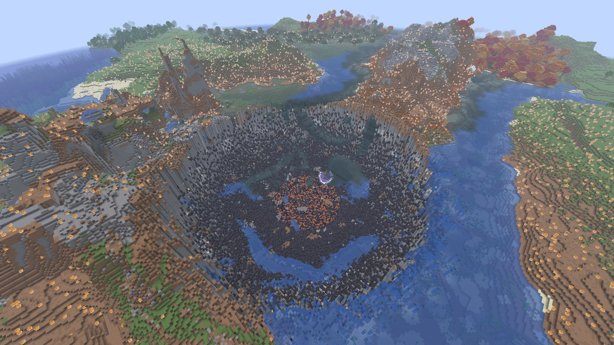<br><sub><b>What 10,000 TNT leaves.</b> A crater so wide a river now runs into it.</sub></td>
  </tr>
  <tr>
    <td>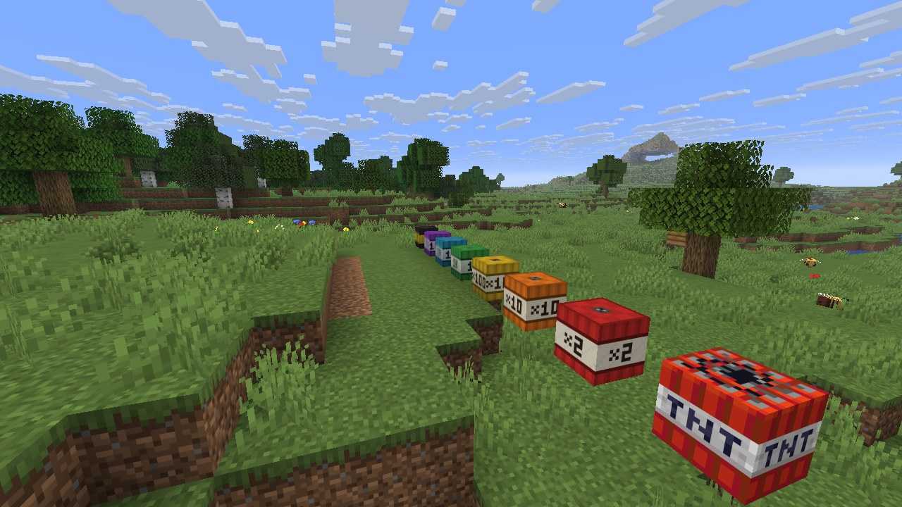<br><sub><b>The lineup.</b> All eight TNT blocks on the grass, vanilla TNT nearest, TNT x1,000,000 at the far end.</sub></td>
    <td>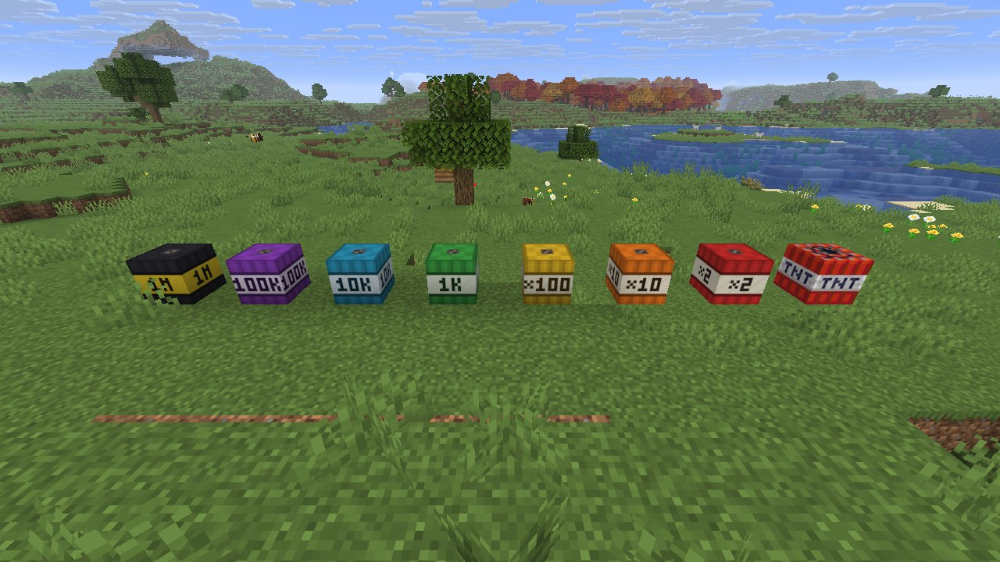<br><sub><b>Side by side.</b> From TNT x1,000,000 down to plain TNT, each with its own texture.</sub></td>
  </tr>
</table>

## Old vs new

<table>
  <tr>
    <th width="50%">Old (0.8)</th>
    <th width="50%">New (0.11)</th>
  </tr>
  <tr>
    <td><a href="https://github.com/user-attachments/assets/d2015f20-e6d9-42c7-b8ef-e2eb0959690b">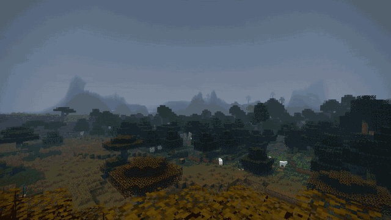</a></td>
    <td><a href="https://github.com/user-attachments/assets/41347575-c2d8-4d19-b7b3-6256a74888e9">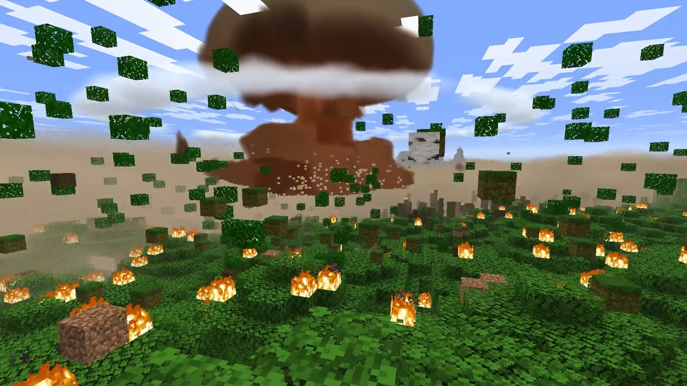</a></td>
  </tr>
  <tr>
    <td><sub>One cube of 25,087 TNT from about 300 blocks away (15 s, with sound), shown with the
    <code>wisdom_horizon_tnt</code> shader pack.</sub></td>
    <td><sub>One TNT x10,000, set off with the remote detonator (15 s, with sound): the fireball, the condensation
    ring, the ground thrown up and the mushroom cloud. Every TNT from x2 to x1,000,000 in the
    <a href="https://youtu.be/rC_2Uwb9i0E">full 3-minute showcase</a>.</sub></td>
  </tr>
</table>

### The blast in the old clip: 25,087 TNT

A cube of 25,087 TNT, lit with flint and steel. The countdown over the hotbar gave **55 seconds** to fly
away; the shockwave reached **527 blocks**.


| | 25,087 TNT |
|---|---|
| Fuse (time to get away) | 55 s, counted down over the hotbar |
| Fireball and mushroom cloud | 141 blocks, lasting 65 s |
| Crater | 132 blocks out from the centre, charred floor, magma near the middle |
| Brick and stone buildings fall | out to 220 blocks |
| Turf and topsoil torn off | out to 261 blocks |
| Trees and wooden houses fall | out to 333 blocks |
| Glass, leaves and plants go | out to 374 blocks |
| Shockwave hurts and throws mobs and players | out to 527 blocks, its front running at 227 blocks a second |
| Damage at the centre | 468 health points (`minecraft:explosion`), falling off with the square of the distance |
| Knockback | 40 times vanilla's push, capped at Horizon's top speed |

## Install

Realistic TNT is a native mod: real code, compiled for **one exact Horizon**, Nightly 2026-11-22
(`f1bb66f`). The launcher builds it for that Horizon and keeps an instance on it, so a later Horizon
update does not break your TNT worlds. The mod gets an instance of its own, so your main game stays
as it is.

> [!IMPORTANT]
> **While Horizon's GitHub is down** (see the warning at the top), do **step 0** first, in the same
> terminal window you use for steps 1 to 3. It points the launcher at the Horizon team's mirror of
> the mod SDK. Once the mod is built, the SDK stays on your computer and you won't need it again.
>
> **Step 0 (Windows, PowerShell).** Paste this and press Enter. Nothing appears; that's normal.
>
> ```powershell
> $env:HORIZON_SDK_BASE = "https://horizon-mirror.nikitagrimm.de"
> ```
>
> On Linux or macOS, put `HORIZON_SDK_BASE=https://horizon-mirror.nikitagrimm.de ` in front of
> each `horizon-launcher` command below.
>
> If you close the terminal before step 3, do step 0 again in the new one. If the launcher says
> Horizon Nightly 2026-11-22 itself is missing, its download is on GitHub too: get Horizon from the
> temporary downloads on Horizon's Discord, then come back here.

**You need:**

- Horizon's launcher, from [playhorizon.dev](https://playhorizon.dev).
- To be signed in to it with an account that owns Minecraft: Java Edition.

Open a terminal: on Windows, press the Windows key, type `PowerShell` and press Enter (on macOS open
**Terminal**, on Linux your terminal app). Run the three commands below one at a time: copy a whole
command, paste it into the terminal (right-click or Ctrl+V), press Enter, and wait until it finishes
before the next one. Copy each command exactly as it is, quotes included.

**First, tell the terminal where the launcher is.** The launcher is the `horizon-launcher.exe` file
you downloaded; a new terminal does not know where you saved it. On Windows:

1. Right-click `horizon-launcher.exe` (hold **Shift** while you right-click if you don't see it) and
   pick **Copy as path**.
2. In the terminal, type `Set-Alias horizon-launcher ` (with a space at the end), paste with Ctrl+V and
   press Enter. It looks like this, with your own path:

   ```powershell
   Set-Alias horizon-launcher "C:\Users\you\Downloads\horizon-launcher.exe"
   ```

Nothing appears; that's normal. From now on, `horizon-launcher` works in this window. If you open a
new window, do this again. On macOS and Linux, if `horizon-launcher` is not found, type the launcher's
full path in its place in each command below.

**Then check that it answers.** Run this:

```sh
horizon-launcher instance list
```

**You should see:** a list of your instances, or an empty list. Either way, you are ready for step 1.
If it says the command is not found, see the first row of [If something goes wrong](#if-something-goes-wrong).

If you prefer the launcher window, steps 1 and 2 can also be done there (written under each
command). Step 3, the build, is done with the command.

### Step 1. Make an instance for the mod

This creates a separate game profile called `Realistic TNT`.

```sh
horizon-launcher instance create "Realistic TNT"
```

**You should see:** the new instance `Realistic TNT` in the launcher's list.

**In the window:** **Instances > New instance**, name it `Realistic TNT`.

### Step 2. Add the mod to that instance

This downloads the mod from the v0.11.0 release into the instance. It does not build it yet.

```sh
horizon-launcher mods add-github https://github.com/stealer0002/horizon-realistic-tnt/releases/tag/v0.11.0 --instance "Realistic TNT" --trust-native-code
```

**You should see:** the mod installed (`Installed realistic_tnt 0.11.0 from GitHub`), and a message
that ends with **"Build it next"**. Just before it, the launcher prints *"Not reviewed by the Horizon
registry. Native mods run with full access to this computer."* That is expected: it is the warning
that goes with `--trust-native-code`, and the source is in this repository. Go on to step 3.

**In the window:** pick the `Realistic TNT` instance, open **Mods > Add from GitHub**, paste
`https://github.com/stealer0002/horizon-realistic-tnt/releases/tag/v0.11.0` and allow native code.

### Step 3. Build the mod

This compiles the mod for the Horizon it is made for (Nightly 2026-11-22, `f1bb66f`) and sets the
instance to play that build. It takes a few minutes the first time.

```sh
horizon-launcher native-build --instance "Realistic TNT" --trust-native-code
```

**You should see:** `Your mods are built`, then a line like
`native-f1bb66f-8c77f8d78b76 built and selected for its instance.` The instance now plays a version
named `native-f1bb66f-` followed by 12 letters and digits (yours will differ). With Horizon Nightly
2026-11-22 already installed, it took about a minute.

**In the window:** do this step with the command. Even if you did steps 1 and 2 in the window, open a
terminal and run the command above.

A native mod runs with your rights, which is why the launcher asks you to trust it with
`--trust-native-code`. The whole source is in this repository.

### Step 4. Play

Select the `Realistic TNT` instance and press **Play**.

- In a **Creative** world, the TNT blocks and the Remote Detonator are in the creative tab **Realistic TNT**.
- In Survival, craft them: see the recipes in [TNT blocks](#tnt-blocks) and [Remote detonator](#remote-detonator).
- With cheats on (or as an operator), type in chat: `/give @p realistic_tnt:tnt_x1000` and
  `/give @p realistic_tnt:detonator`.

Before you light your first TNT, do step 5. It takes ten seconds, and the fireball and the mushroom
cloud only show up once it is done.

### Step 5. Turn on the shader pack

The fireball, the mushroom cloud, the flash, the shockwave and the condensation ring are drawn by a
shader pack. The mod puts its pack in your instance when the game starts, and the pack starts
**switched off**. You turn it on once:

1. In the game, open **Options > Video Settings** and go to the **Shaders** tab.
2. Press **Shader Packs...**
3. Click **Realistic TNT: explosions** until the line reads **Realistic TNT: explosions: On**.

**You should see:** the line ends in `On`, and the hint under it says the pack is in use. Light a TNT
and the blast has a fireball, a mushroom cloud and a ring of dust. The game remembers the choice, so
you do not have to do this again. If **Realistic TNT: explosions** is not in the list, quit the game
and start it again from the `Realistic TNT` instance.

The mod never changes the pack you picked. Without the shader pack, the craters, debris, damage,
sounds and everything else marked "no" in [What every explosion does](#what-every-explosion-does)
still work.

### If something goes wrong

| What you see | What to do |
|---|---|
| The blast has no fireball, no mushroom cloud and no shockwave, only a crater, fire and flying debris | The shader pack is still off (it starts that way). Do [step 5](#step-5-turn-on-the-shader-pack): **Options > Video Settings > Shaders > Shader Packs...**, then click **Realistic TNT: explosions** until it says **On**. |
| `horizon-launcher` is not found | The terminal does not know where the launcher is. Do the `Set-Alias` line in [Install](#install) again, in the same window (it only lasts for that window). If you have not downloaded the launcher yet, get it from [playhorizon.dev](https://playhorizon.dev). Still not found? Open an issue on this repository and say which system you use. |
| Step 2 ended with "Build it next" | That is expected. Run step 3. |
| Step 3 fails with a 404 or a download error | Horizon's GitHub is down. Do step 0 in the same terminal, then run step 3 again. |
| No **Realistic TNT** tab in the game, or the game says a mod was left out | The instance was moved to another Horizon. Follow [Keep playing after Horizon updates](#keep-playing-after-horizon-updates). |
| The build in step 3 fails because that Horizon is missing | The mod needs Horizon Nightly 2026-11-22 (`nightly-2026-11-22-f1bb66f`). Install that exact version in the launcher, then run step 3 again. |
| The build in step 3 fails with another error | Run step 3 again. If it still fails, open an issue on this repository and attach the build log, `%APPDATA%\horizon-launcher\native\build.log` on Windows. |
| The flash hurts your eyes | Set the pack's **Explosion flash** option to 0. |

### Keep playing after Horizon updates

The instance stays on the Horizon it was built for. A Horizon update installs beside it and does not
move it. Two rules keep it that way:

- Do not run `native-build` with `--update` for this instance: it moves the instance to the newest
  installed Horizon. If you rebuild, use the command in step 3 below, which keeps it on Nightly 2026-11-22.
- Do not let the launcher delete the Horizon the mod needs. Run this once:

```sh
horizon-launcher settings prune-old-versions off
```

**If the mod stopped working**, put the instance back on the mod's build:

1. List the versions you have:

   ```sh
   horizon-launcher versions --installed
   ```

2. Find the line that starts with `native-f1bb66f-`. Put that exact name in place of
   `native-f1bb66f-XXXXXXXXXXXX` here:

   ```sh
   horizon-launcher instance version "Realistic TNT" native-f1bb66f-XXXXXXXXXXXX
   ```

3. If there is no such line, build the mod again on its own Horizon:

   ```sh
   horizon-launcher native-build --instance "Realistic TNT" --version nightly-2026-11-22-f1bb66f --trust-native-code
   ```

When a version of the mod for a newer Horizon comes out, install it into a new instance the same way,
and keep this one until you have tried the new one.

## TNT blocks

<p align="center"></p>

Seven TNT blocks of greater worth, in the **Realistic TNT** creative tab, so huge blasts do not need
thousands of placed blocks. Each is crafted from the one below it (all shapeless recipes):

| Block | ID | Worth (in TNT) | Recipe |
|---|---|---:|---|
| TNT x2 | `realistic_tnt:tnt_x2` | 2 | 2 × TNT |
| TNT x10 | `realistic_tnt:tnt_x10` | 10 | 5 × TNT x2 |
| TNT x100 | `realistic_tnt:tnt_x100` | 100 | 9 × TNT x10 |
| TNT x1,000 (1K) | `realistic_tnt:tnt_x1000` | 1,000 | 9 × TNT x100 |
| TNT x10,000 (10K) | `realistic_tnt:tnt_x10000` | 10,000 | 9 × TNT x1,000 |
| TNT x100,000 (100K) | `realistic_tnt:tnt_x100000` | 100,000 | 9 × TNT x10,000 |
| TNT x1,000,000 (1M) | `realistic_tnt:tnt_x1000000` | 1,000,000 | 9 × TNT x100,000 |

<p align="center">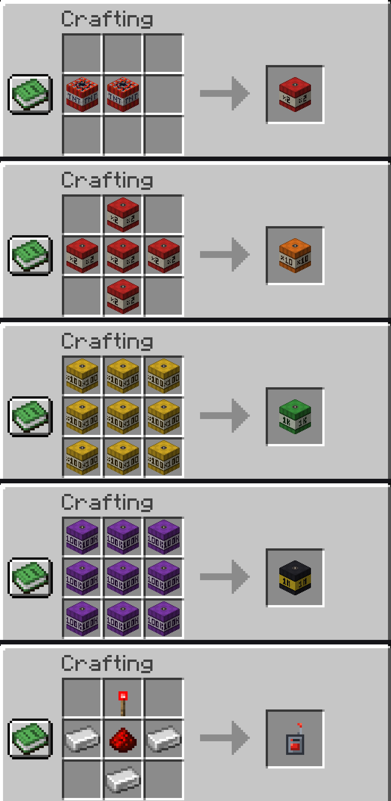</p>

They break instantly, drop themselves when mined, and light the way vanilla TNT does:

- **Redstone:** any adjacent redstone signal lights them, also at once if you place one where a
  signal already reaches.
- **Flint and steel:** right-click to light. It wears the flint and steel down, as on vanilla TNT.
- **Fire charge:** right-click to light. The fire charge is used up (outside Creative).
- **Fire and explosions:** spreading fire and nearby blasts light them instead of breaking them.

Each lit block becomes a primed TNT that shows the block's own texture and explodes with its full
worth. Touching TNT blocks, vanilla or valued, fold into one mass and add their worths together, up
to **10,000,000 TNT** per blast.

## Remote detonator

The **Remote Detonator** (`realistic_tnt:detonator`, in the **Realistic TNT** creative tab) sets off
TNT from far away. Shaped recipe:

| | | |
|:-:|:-:|:-:|
| | Redstone torch | |
| Iron ingot | Redstone dust | Iron ingot |
| | Iron ingot | |

How to use it:

1. **Link:** right-click a TNT block (vanilla or valued) with the detonator. The action bar shows
   how many are linked, for example `Linked TNT (3/64)`.
2. **Unlink:** right-click a linked block again.
3. **Fire:** right-click in the air (not at a block). Every linked block that is still TNT lights
   with a fixed **5 second (100 tick)** fuse.

Good to know:

- Each detonator keeps its own list on the item: up to **64** links in all, each remembered with its dimension.
- The 5 second fuse replaces the mod's longer fuse for big masses. The blast is the same: touching
  blocks still fold into one mass and add up.
- The links are cleared when you fire. Blocks that were broken or replaced, or that sit in unloaded
  chunks, are skipped, and the detonator tells you how many.

## How it scales

Every explosion has a **yield** in TNT: one TNT is 1, a creeper about 0.4, a bed or a respawn anchor
about 2, an end crystal about 3.4. TNT blocks touching an explosion go off with it at once (up to
200,000 blocks), and explosions close together within two seconds are one blast whose yield is their
sum. Everything grows with the **cube root of the yield**, as real blasts do, up to the cap of
10,000,000 TNT per blast.


Distances in blocks from the centre of the blast:

| TNT | Fuse | Crater | Brick and stone fall | Turf torn off | Trees and wood fall | Glass and plants go | Shockwave reach | Front speed |
|---:|---:|---:|---:|---:|---:|---:|---:|---:|
| 1 | 4 s | vanilla's | – | – | – | – | 18 | 42 blocks/s |
| 27 | 7.6 s | 14 | – | – | – | – | 54 | 73 blocks/s |
| 512 | 16.6 s | 36 | 44 | 57 | 81 | 94 | 144 | 119 blocks/s |
| 4,096 | 31 s | 72 | 107 | 132 | 174 | 198 | 288 | 168 blocks/s |
| **25,087** (the video) | 55 s | 132 | 220 | 261 | 333 | 374 | 527 | 227 blocks/s |
| 1,000,000 | 3 min | 450 | 876 | 1,000 | 1,215 | 1,338 | 1,800 | 420 blocks/s |

Land is torn up past the crater by blasts of 64 TNT or more. A single TNT keeps vanilla's blast, with
the mod's effects on top.

## What every explosion does

TNT, creepers, beds, end crystals: every explosion gets all of this.

| Part | What happens | Needs the shader pack |
|---|---|---|
| Fireball | A white-hot ball that cools to yellow, orange and red as it rises, lighting the land round it. | yes |
| Mushroom cloud | The fireball rolls up into black smoke on a stem, which greys, spreads and fades. | yes |
| Flash | The whole picture whitens for an instant (an option of the pack; 0 turns it off). | yes |
| Shockwave | A sphere of bent air races out, with colour fringes. | yes |
| Dust skirt | A low ring of dust races out along the ground and settles. | yes, plus dust pillars without it |
| Condensation ring | Round a big blast's mushroom (from about 64 TNT, in full from a few thousand), the shockwave chills the damp air into a ragged white ring (a Wilson cloud) that drifts slowly outwards and frays away. | yes |
| Debris | Plain terrain and wood the blast breaks flies as falling blocks, trailing smoke, and lands as rubble. Ores, containers and block-entity blocks are left to the blast, so loot is not lost. | no |
| Sparks, flames, crumbs | A flash particle, lava sparks, a burst of flame and crumbs of the ground it tore up. | no |
| Smoke and ash | A column of smoke with a cloud at its top, embers at its foot, ash falling afterwards. | no |
| Scorched ground | Grass and soil round the crater char to coarse dirt, plants burn away. | no |
| Camera shake | A jolt as it goes off, then a shake when the shockwave reaches you (scaled by the game's Distortion Effects option). | no |
| Sound | Heard as a real blast is (modelled on recordings of the 2020 Beirut blast): the fireball's roar with the flash, the ground rumbling ahead of the air wave, then, as the shockwave arrives, a sharp crack and the boom (heavy close by, a dull thud far off, where the air has taken its high pitches), the boom rolling on like thunder, debris raining down, and close by the ears ringing while the world sounds muffled. It grows with the yield: one TNT is a crisp, punchy bang; tens of TNT shake the ground; a nuclear-sized blast roars for seconds, rolls on for twenty and its wind howls after it. The booms, rumbles, debris and cracks are real recorded explosions (the SSE Library's *EXPLOSIONS*, CC0 1.0), given back the deep lows old tape lost and the chest-thumping blow of a blast felt close by. The flash, ground, wind and ringing are synthesised. All of them are made by `tools/make_sounds.py` into `assets/realistic_tnt/sounds/blast/`. Vanilla's explosion sound is dropped, so the blast is not heard twice. | no |
| Shockwave damage and push | As the front reaches them, mobs and players are hurt and thrown away from the blast, less the farther out. The hit lands even on a mob that was just hurt, so what should die does. | no |
| Knockback | The explosion's own push is 35% harder, times the cube root of the yield. | no |
| Crater | A blast of more than one TNT digs its own crater, ring by ring as its front passes: a bowl, everything above it cut away, a charred floor (blackstone, coarse dirt, magma near the middle), the land round it scorched, blocks flung out of it. | no |
| Land torn up | A blast of 64 TNT or more knocks down what its shockwave sweeps over beyond the crater, by how hard it still pushes there: glass, leaves, plants, wool and torches first, then wood (trees, wooden houses, doors, fences), then the turf, then brick, cut stone, cobblestone and concrete. As much of it as the game allows flies up and away where players can see it. Natural rock, ores, metal and blocks holding things (chests, signs, beds) stay. | no |
| Crater rim | The ground the crater throws out piles round it in low, broken mounds with gaps, from the crater's edge out to about one and a half times its radius. Small craters (8 blocks or less) get no rim; big ones a few blocks high at most, never more than 8. | no |
| Walls slide in | Once a crater of 6 blocks or more is dug, its steep walls keep breaking off and sliding into it for a few seconds (up to half a minute for the biggest), even where chunks are unloaded. | no |
| Fires | A blast of 16 TNT or more sets the land round its crater alight, out past where its shockwave knocks the trees down (at least 2.5 times the crater's radius), so the forest still standing catches; the game's fire spreads it from there (`FIRE`). | no |
| Debris craters | Ground the blast throws far comes down hard and digs a small crater of its own where it lands, with a puff of dust. | no |
| Baked ground | The heat bakes the crater's whole bowl two blocks deep, each material as it would: sand and sandstone to glass, stone, cobblestone and deepslate to blackstone, stone bricks crack, soil to coarse dirt, clay to terracotta, mud dries, gravel fuses to tuff, snow, ice and leaves go, netherrack glows to magma. What the crater throws out and its walls shed comes down baked the same way. Rock in the middle melts to magma, and under 64 TNT or more some of it to obsidian. | no |

## Lighting a big mass

**A bigger mass burns longer.** TNT lit in a mass gets vanilla's 4 seconds plus the time it takes to
fly out of the shockwave's reach at 10 blocks a second (`ESCAPE_SPEED`). TNT on its own keeps
vanilla's fuse. The remote detonator overrides this with its fixed 5 seconds.

**A countdown** over the hotbar shows the mass, the seconds left and the shockwave's reach:
`25,087 TNT: explodes in 51 s, reach 527 blocks`. It reads the lit TNT's own fuse every tick, so it
ends exactly as the TNT goes off. Then it tells you when the shockwave will reach you
(`25,087 TNT went off! The shockwave reaches you in 2 s`), or that you are out of its reach.

**It goes off on time however far you fly.** While a mass burns, the mod keeps the chunks round it
loaded and ticking (the TNT's, the mass's, and out to the land its shockwave tears up, at most 16
chunks out), so it does not freeze when you leave it behind. The chunks are released once the crater
is dug. A world closed while a mass burns releases them when it is opened again.

**The whole mass goes together.** TNT lit later in a mass that is already burning (a second one lit, a
redstone signal reaching several blocks, fire spreading over it) takes the same fuse, and another
blast does not throw the lit TNT out of its mass.

## Command

Use `/tnt <n>` while aiming at a block within 128 blocks. It needs operator level 2 or higher and
takes whole numbers from 1 to 200,000. For example, `/tnt 64` sets off one explosion with the yield of
64 TNT where your aim hits. It places no TNT blocks. Existing TNT touching the explosion can add to its
yield as usual.

## Tuning

Create `config/realistic_tnt.conf` inside the Horizon instance directory (for a dedicated server, that
server's instance directory). The mod reads the UTF-8 file once, while it registers, so restart
Horizon after editing it. Leave out any key to keep its default. Blank lines and comments starting
with `#` are allowed. Invalid entries are ignored and reported to stderr.

```ini
ESCAPE_SPEED = 10
MAX_FOLD = 200000
HOLD_CHUNKS = 16
LIFT_YIELD = 64
BREAKS_AT = 0.5, 0.8, 1.5, 2.0
SCORCH = true
FIRE = true
KNOCKBACK = 1.35
```

| Key | Accepted values | What it controls |
|---|---|---|
| `ESCAPE_SPEED` | Positive finite number | Assumed escape speed in blocks per second. Lower values give larger TNT masses a longer fuse. |
| `MAX_FOLD` | Positive integer | Maximum TNT blocks one explosion takes in at once. |
| `HOLD_CHUNKS` | Integer from 1 to 32 | Radius cap, in chunks, for the area held around a burning mass. |
| `LIFT_YIELD` | Positive finite number | Minimum TNT yield that tears up land beyond the crater. |
| `BREAKS_AT` | Four finite, nonnegative numbers in strictly increasing order | Shockwave push, in blocks per tick, needed to knock down glass and plants, wood, turf, then brick and stone. |
| `SCORCH` | `true` or `false` | Whether explosions scorch the surrounding land. |
| `FIRE` | `true` or `false` | Whether blasts of 16 TNT or more set fires round their crater, which then spread as fire does. |
| `KNOCKBACK` | Finite, nonnegative number | Multiplier for the explosion's initial knockback. |

## Limits

- A huge mass freezes the game for a moment as it goes off (the mod walks the whole mass), and a huge
  crater takes a few seconds to dig.
- Horizon keeps at most 1024 falling blocks in a world. What a big shockwave knocks down flies while
  there is room (as flying blocks land, more fly), only within 160 blocks of a player, and the rest is
  simply gone. It looks 40 blocks down from the top of each column at most.
- The fireball, cloud, flash, shockwave picture, camera shake and delayed boom read the blasts from
  the game's own memory. They work in single player and for the host of a LAN game, not for guests or
  on a dedicated server. Debris, particles, craters, damage, knockback and the countdown work
  everywhere.
- The shockwave throws the window's own player. Other players in a LAN game are hurt but not thrown.
- A world saved and reopened while a mass burns keeps the TNT's long fuse, but not its countdown nor
  its held chunks.
- The shader pack draws three blasts at a time: the biggest and youngest.
- Particles are seen up to 32 blocks away, as vanilla's are. The fireball and cloud are seen from any
  distance.
- **Photosensitivity:** explosions flash. The pack's "Explosion flash" option at 0 removes the flash.

## From the source (developers)

Build the mod from this repository into an instance of your own:

```sh
horizon-launcher native-build realistic_tnt --instance "<your instance>" --version nightly-2026-11-22-f1bb66f --trust-native-code
```

`realistic_tnt/` is the mod's project on its own (the folder a `.hmod` is packed from), so the shader
packs, scripts and media live beside it. To pack a `.hmod` yourself, run this inside `realistic_tnt/`.
It writes `target/horizon-mod/realistic_tnt.hmod`.

```sh
cargo horizon-mod build
```

**Shader packs.** When the game starts, the mod writes "Realistic TNT: explosions" into the game's
`shaderpacks/realistic_tnt_shockwave/` folder, and updates it when a newer mod carries a newer pack.
The packed files below are the same packs, for players who want them on their own.

| Pack | What it is |
|---|---|
| `realistic_tnt_shockwave-0.6.0.hshader` | The explosion pass alone, over the game's vanilla look (shader API 0.2). The mod installs this one by itself. |
| `wisdom_horizon_tnt-1.3.7-tnt6.hshader` | Wisdom Shaders V3 (Horizon port) with the explosion pass added: the look in the original clip. It is a shader API 0.1 pack, which Horizon no longer loads since 2026-11-13, so it is kept for older builds only. |

## Repository layout

```text
realistic_tnt/                 the mod's project: what native-build builds and .hmod packs
  horizon-mod.toml             id, version, the Horizon build it is made for
  src/lib.rs                   the blast, fuse, valued-TNT and effects logic, with unit tests
  src/command.rs               server-side /tnt command
  src/config.rs                instance tuning and config parser tests
  src/destruction.rs           crater rim, wall slumping, blast fires, baked ground and debris craters
  src/detonator.rs             remote detonator item behaviour and link-list tests
  src/shader_pack.rs           installs the explosion shader pack into shaderpacks/ on start
  src/shader_pack_files.rs     that pack's files, generated by tools/embed_shader.py
  assets/realistic_tnt/        valued TNT and detonator models, textures, lang files and blast sounds
  data/realistic_tnt/          valued TNT blocks, detonator item, recipes, loot tables and creative tab
shader/
  realistic_tnt_shockwave/     the explosion pass on its own (source)
  wisdom_horizon_tnt/          Wisdom Shaders V3 (Horizon port) with that pass added (source)
  *.hshader                    the same packs, packed, ready to drop into shaderpacks/
tools/
  check.ps1                    checks and unit-tests the mod with the pinned build's mod SDK
  embed_shader.py              packs shader/realistic_tnt_shockwave/ and embeds it in the mod:
                               run it after every change to the shader
  make_blocks.py               writes the valued TNT blocks and the remote detonator: textures, models,
                               recipes, loot and lang files
  make_sounds.py               generates the blast's .ogg sound files under assets/realistic_tnt/sounds/blast/
                               (fetches its CC0 recordings into tools/sounds-source/ the first time)
  diagrams.py                  draws media/blast-*.svg from the mod's own formulas
  shoot.py, bigtest.py, ...    drive a test copy of the game through horizon-ctl to photograph
                               explosions and check fuses, far-away blasts and torn-up land
media/                         the banner, the clip, its preview, the gallery and the diagrams
```

The shader pass and the mod share numbers that must stay the same in both: the layout of `frame.mods`,
the shockwave's speed (`SHOCK_SPEED`, `TNT_SHOCK_SPEED`), a blast's life (`LIFE_SECS`, `TNT_LIFE`) and
the curves of the mushroom and of the dust ring. `post/shockwave.wgsl` is the same pass in both packs;
the explosion pack's copy is the shader API 0.2 one, which works in linear light.

## License and credits

- Made with [Claude Code](https://claude.com/claude-code), Anthropic's coding agent, using the
  Claude Opus 5.5 and Claude Fable 5.2 models: the mod's code, the shader pass, the test scripts, the
  diagrams and this README were written with it.
- Also made with Google's [Antigravity](https://antigravity.google), using the Gemini 4 Neon and
  Gemini 4 Hydrogen models: valued TNT going off at its full worth, the remote detonator, the
  natural crater rims and the shockwave that kills what it reaches (0.10.0 and 0.11.0).
- The blast sounds are cut from real explosions recorded in the SSE Library's *EXPLOSIONS* (USC
  Cinema / Sunset Editorial), released under CC0 1.0 on the
  [Internet Archive](https://archive.org/details/SSE_Library_EXPLOSIONS).
- The mod, the explosion shader pass and the scripts: MIT ([LICENSE](LICENSE)).
- `shader/wisdom_horizon_tnt/` is a modified copy of **Wisdom Shaders V3 (Horizon port)**: Wisdom
  Shaders by bobcao3, ported to Horizon by tomasmendes01, under the Apache License 2.0
  ([its LICENSE](shader/wisdom_horizon_tnt/LICENSE.txt)). The changes are listed in
  [its README](shader/wisdom_horizon_tnt/README.md).
- Horizon is its own project; this mod is not affiliated with it, nor with Mojang or Microsoft.
